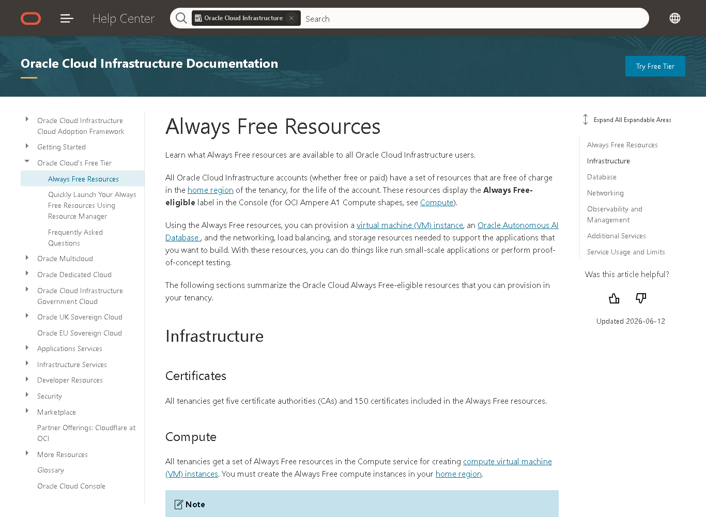
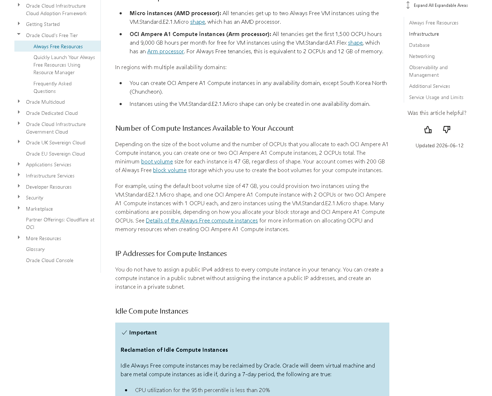

# 01 · Entender o Oracle Cloud Free Tier

## Objetivo

Descobrir o que é gratuito de fato na Oracle Cloud Infrastructure (OCI), o que expira e onde pode haver cobrança. A ideia é fazer isso antes de criar qualquer recurso, para que as escolhas dos capítulos seguintes caibam no gratuito.

Todas as fontes foram consultadas em 19/10/2026. A página principal de recursos Always Free mostrava "Updated 2026-06-12".

## Resumo do Free Tier

O Free Tier da Oracle tem duas partes independentes ([Oracle, *Oracle Cloud Free Tier*](https://docs.oracle.com/en-us/iaas/Content/FreeTier/freetier.htm)):

1. **Free Trial (crédito de teste).** São US$ 300 em créditos, válidos por até 30 dias. Durante esse período dá para usar quase qualquer serviço pago. Quando os créditos ou o prazo acabam, os recursos pagos criados com o crédito são recuperados (apagados) pela Oracle, a menos que a conta seja convertida em paga.
2. **Always Free (sempre gratuito).** É um conjunto de recursos com limites fixos que "nunca expiram". Vale para qualquer conta, gratuita ou paga, e só na **região home** da conta. Esses recursos aparecem no console com o rótulo *Always Free-eligible*.

**O que acontece quando o teste termina.** A conta continua ativa e os recursos Always Free continuam funcionando. O que passou do limite gratuito é desativado e depois apagado. Dois casos merecem atenção:

- **Instâncias Ampere A1.** Se a soma das instâncias A1 passar do limite Always Free, todas são desativadas e apagadas em 30 dias. A própria Oracle recomenda terminar o teste com no máximo 2 OCPUs e 12 GB somados em todas as instâncias A1.
- **Object Storage.** Se o uso passar de 20 GB no fim do teste, os objetos são apagados ([Always Free Resources](https://docs.oracle.com/en-us/iaas/Content/FreeTier/freetier_topic-Always_Free_Resources.htm)).

**Região home.** Instâncias e bancos Always Free só podem ser criados na região home. A Oracle define essa região no cadastro e ela não pode ser trocada depois ([Managing Regions](https://docs.oracle.com/en-us/iaas/Content/Identity/regions/managingregions.htm)). O motivo prático é que a região home é onde ficam os recursos de identidade da conta (IAM), e a cota gratuita está presa a ela.

## Recursos Always Free

Fonte de todos os números: [Always Free Resources](https://docs.oracle.com/en-us/iaas/Content/FreeTier/freetier_topic-Always_Free_Resources.htm), salvo indicação.

### Computação

| Recurso | Limite Always Free |
|---|---|
| VM.Standard.E2.1.Micro (AMD, x86) | Até 2 instâncias. Cada uma: 1/8 de OCPU (pode usar CPU adicional ociosa), 1 GB de RAM, 1 VNIC com 1 IP público, até 50 Mbps de banda para a internet. Só pode ser criada em um availability domain. |
| VM.Standard.A1.Flex (Ampere, Arm) | 1.500 OCPU-hora e 9.000 GB-hora por mês. Equivale a 2 OCPUs e 12 GB de RAM no total, divididos como quiser: por exemplo, 1 VM com 2 OCPUs ou 2 VMs com 1 OCPU. |

**Atenção:** muitos tutoriais antigos falam em 4 OCPUs e 24 GB para o A1. A página oficial consultada mostra **2 OCPUs e 12 GB**. Este trabalho usa os números atuais.

### Armazenamento

| Recurso | Limite Always Free |
|---|---|
| Block Volume (boot + dados) | 200 GB no total na região home, mais 5 backups de volume. |
| Boot volume por instância | Mínimo de 47 GB, segundo a seção de Compute. A seção de Block Volume diz 50 GB, ou seja, a própria página diverge. |
| Object Storage + Archive | 20 GB no total, somando Standard, Infrequent Access e Archive, e 50.000 requisições de API por mês. |

### Rede

| Recurso | Limite Always Free |
|---|---|
| VCN (rede virtual) | Até 2 VCNs em contas Free Tier, com IPv4 e IPv6. |
| Saída de dados para a internet | 10 TB por mês. |
| Load Balancer flexível | 1, com banda fixa de 10 Mbps. |
| Network Load Balancer | 1. |
| Site-to-Site VPN | Até 50 conexões IPSec. |
| VCN Flow Logs | 10 GB por mês. |
| Porta 25 (SMTP) de saída | Bloqueada por padrão. |

### Outros recursos citados na página

| Recurso | Limite Always Free |
|---|---|
| Autonomous Database | 2 bancos, cada um com 1 OCPU e 20 GB. |
| MySQL HeatWave | 1 DB system, com 50 GB de dados e 50 GB de backup. |
| NoSQL | 133 milhões de leituras e 133 milhões de escritas por mês, 3 tabelas de 25 GB. |
| Monitoring | 500 milhões de pontos de ingestão e 1 bilhão de pontos de consulta. |
| Notifications | 1 milhão de entregas HTTPS e 1.000 e-mails por mês. |
| Email Delivery | 3.000 e-mails por mês. |
| Vault | Chaves de software ilimitadas, 20 versões de chave em HSM, 150 secrets. |
| Certificates | 5 autoridades certificadoras e 150 certificados. |
| Bastion | Gratuito. A página não informa cota. |

## Riscos de cobrança e como evitá-los

| Risco | Por que acontece | Como evitar |
|---|---|---|
| **Converter a conta em paga (Pay As You Go)** | Depois do upgrade, tudo o que passar do limite Always Free é cobrado no cartão. O próprio console oferece o upgrade quando falta capacidade. | Não fazer upgrade neste trabalho. Se fizer, criar budget com alerta antes (capítulo 02) e usar cotas de compartment. |
| **Criar recurso fora do Always Free durante o teste** | Com crédito, o console aceita shapes pagos sem bloquear. Ao fim do teste, esses recursos são apagados, e se a conta tiver virado paga, passam a ser cobrados. | Conferir o rótulo *Always Free-eligible* em cada recurso. Usar só E2.1.Micro ou A1 até 2 OCPUs e 12 GB. |
| **Passar de 200 GB de block volume** | Cada instância tem boot volume de no mínimo 47 a 50 GB. Volumes extras ou backups somam. | Uma instância com boot de 50 GB. Não criar volumes extras. Apagar boot volumes de instâncias encerradas. |
| **Instância recuperada por ociosidade** | A Oracle pode recuperar uma instância Always Free ociosa. Ociosa quer dizer que, durante 7 dias, o percentil 95 de CPU, o uso de rede e (só no A1) o uso de memória ficaram abaixo de 20%. | Não gera cobrança, mas derruba o app. Estar ciente disso e conferir o console de vez em quando (capítulo 09). |
| **Região home errada** | Não dá para trocar. Os recursos gratuitos só existem nela. | Escolher com cuidado no cadastro (capítulo 02). |
| **Load balancer, IP reservado e outros recursos de rede** | Só alguns têm versão Always Free. | Não criar load balancer neste trabalho. Usar o IP público efêmero da VNIC. |

## Comparação com outros provedores

| | Oracle Cloud | AWS | Google Cloud | Microsoft Azure |
|---|---|---|---|---|
| Crédito inicial | US$ 300 por 30 dias | Até US$ 200 (US$ 100 no cadastro e até US$ 100 por atividades) para contas criadas desde 15/07/2025 | US$ 300 por 90 dias | US$ 200 por 30 dias |
| Fim do período gratuito | A conta continua ativa só com os recursos Always Free | O Free plan expira em 6 meses ou quando os créditos acabam. A conta é suspensa e pode ser apagada após 90 dias sem upgrade | Os recursos param, com 30 dias de carência antes da exclusão | É preciso migrar para pago em 30 dias para manter os serviços de 12 meses |
| VM sempre gratuita | 2 × E2.1.Micro e A1 até 2 OCPUs e 12 GB, sem prazo | Não existe no modelo atual, só crédito | 1 e2-micro por mês, só em us-west1, us-central1 ou us-east1 | Serviços de 12 meses mais uma lista de serviços sempre gratuitos |
| Saída de dados gratuita | 10 TB por mês | Conforme o plano | 1 GB por mês (a partir da América do Norte) | Conforme o serviço |

Fontes: [AWS Free Tier update (blog oficial, 15/07/2025)](https://aws.amazon.com/blogs/aws/aws-free-tier-update-new-customers-can-get-started-and-explore-aws-with-up-to-200-in-credits/), [AWS Free Tier FAQ](https://aws.amazon.com/free/free-tier-faqs/), [Google Cloud free features](https://docs.cloud.google.com/free/docs/free-cloud-features), [Azure free account](https://azure.microsoft.com/en-us/pricing/purchase-options/azure-account), [Azure free services](https://azure.microsoft.com/en-us/pricing/free-services).

**Conclusão:** para manter um servidor no ar sem prazo e sem custo, a Oracle é a mais generosa das quatro. É a única com VM sempre gratuita em região brasileira e com 10 TB de saída. O ponto fraco é a disponibilidade: o A1 costuma dar "out of host capacity" (capítulo 04), e a conta exige cartão para validação.

## Registro

- **Objetivo:** levantar regras e limites antes de criar qualquer recurso.
- **O que fiz:** li a documentação oficial da Oracle e as páginas oficiais da AWS, do Google e da Microsoft, e capturei a página de recursos Always Free.
- **O que deu errado:** os números do A1 que eu tinha de tutoriais (4 OCPUs e 24 GB) não batem com a página oficial atual (2 OCPUs e 12 GB). A página também diverge sobre o boot volume mínimo (47 ou 50 GB). A página comercial `oracle.com/cloud/free` devolveu HTTP 403 para a ferramenta de leitura automática.
- **Como corrigi:** usei só a documentação técnica (`docs.oracle.com`) como fonte de números e registrei as duas divergências, com a data da consulta.

## Fontes

- Oracle. *Oracle Cloud Free Tier.* <https://docs.oracle.com/en-us/iaas/Content/FreeTier/freetier.htm>
- Oracle. *Always Free Resources.* <https://docs.oracle.com/en-us/iaas/Content/FreeTier/freetier_topic-Always_Free_Resources.htm>
- Oracle. *Managing Regions.* <https://docs.oracle.com/en-us/iaas/Content/Identity/regions/managingregions.htm>
- Oracle. *Changing the payment method* (autorizações de US$ 1 e US$ 100). <https://docs.oracle.com/en-us/iaas/Content/Billing/Tasks/changingpaymentmethod.htm>
- AWS, Google Cloud e Microsoft: links na tabela de comparação.
- **Uso de IA:** o Claude (Anthropic), pelo Claude Code, fez o levantamento inicial das páginas oficiais e a redação do rascunho. Os números da Oracle foram conferidos de novo na página oficial antes de entrar no texto.
