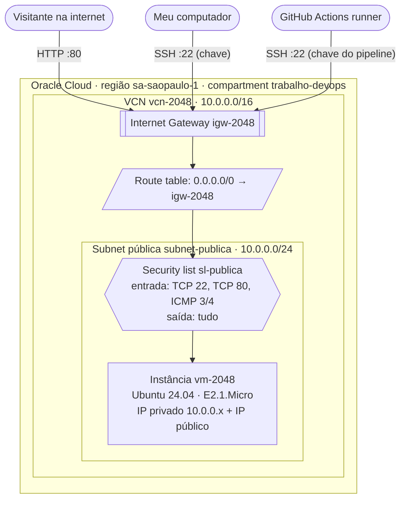

# 03 · Entender e montar a rede

## Objetivo

Montar uma rede em que o servidor seja alcançável só nas portas de que o app precisa: 80 para o site e 22 para administração e deploy. Nenhuma outra porta deve ficar aberta.

## Conceitos, com minhas palavras

**Compartment.** Uma pasta lógica dentro da conta, onde ficam os recursos. Serve para organizar e para controlar acesso e custo: políticas de IAM, cotas e budgets podem ser aplicados a um compartment. Criei um compartment só para o trabalho. Assim tudo o que pertence a ele fica junto, e no fim é fácil conferir se algo foi esquecido ([Oracle, *Setting up your tenancy*](https://docs.oracle.com/en-us/iaas/Content/GSG/Concepts/settinguptenancy.htm)).

**VCN (Virtual Cloud Network).** A rede privada virtual da conta dentro da região, equivalente à rede de um escritório, mas definida por software. Tem uma faixa de endereços (CIDR) da qual saem os IPs das máquinas. Nada entra nem sai dela sem um gateway ([Networking overview](https://docs.oracle.com/en-us/iaas/Content/Network/Concepts/overview.htm)).

**Subnet pública.** Um pedaço da VCN, com uma faixa menor de endereços. Ser "pública" quer dizer que as máquinas dela podem receber um IP público. Uma subnet privada não permite isso. O servidor precisa ser acessado da internet, então fica numa subnet pública.

**Internet Gateway.** A porta entre a VCN e a internet. Sozinho não faz nada: o tráfego só passa por ele quando a **route table** da subnet tem uma regra mandando o destino `0.0.0.0/0` (qualquer endereço fora da VCN) para o gateway ([Internet Gateway](https://docs.oracle.com/en-us/iaas/Content/Network/Tasks/managingIGs.htm)).

**Route table.** A tabela que diz para onde vai cada pacote que sai da subnet, de acordo com o destino ([Route tables](https://docs.oracle.com/en-us/iaas/Content/Network/Tasks/managingroutetables.htm)).

**Security list.** O firewall da nuvem, aplicado a todas as placas de rede (VNICs) da subnet. Tem regras de entrada e de saída ([Security lists](https://docs.oracle.com/en-us/iaas/Content/Network/Concepts/securitylists.htm)).

**Regra de entrada (ingress) e de saída (egress).** Ingress é o tráfego que **chega** à máquina, como um visitante abrindo o site. Egress é o tráfego que **sai** dela, como o servidor baixando atualizações. Uma regra *stateful* lembra a conexão: se a entrada na porta 80 é permitida, a resposta sai sem precisar de regra de saída própria. Uma regra *stateless* não lembra, e o tráfego de volta precisa de outra regra ([Security rules](https://docs.oracle.com/en-us/iaas/Content/Network/Concepts/securityrules.htm)). Usei só regras stateful.

**Network Security Group (NSG).** Uma alternativa à security list, aplicada por VNIC em vez de por subnet. A Oracle recomenda NSG quando há máquinas com papéis diferentes na mesma subnet. Aqui há uma única máquina, então a security list basta e é mais fácil de explicar ([NSG](https://docs.oracle.com/en-us/iaas/Content/Network/Concepts/networksecuritygroups.htm)).

## Diagrama da rede

## Passo a passo no console

Todos os passos no compartment `trabalho-devops`, região São Paulo.

1. **Compartment:** **Identity & Security**, **Compartments**, **Create Compartment**. Nome `trabalho-devops`, pai: root.
2. **VCN:** **Networking**, **Virtual Cloud Networks**, **Create VCN** (a criação manual, não o assistente). Nome `vcn-2048`, IPv4 CIDR `10.0.0.0/16`, DNS habilitado.
   - Não usei o assistente "VCN with Internet Connectivity" porque ele cria também subnet privada, NAT Gateway e Service Gateway, que este app não usa.
3. **Internet Gateway:** dentro da VCN, **Internet Gateways**, **Create**. Nome `igw-2048`.
4. **Route table:** na **Default Route Table** da VCN, **Add Route Rules**. Destino `0.0.0.0/0`, alvo: Internet Gateway `igw-2048`.
5. **Security list:** dentro da VCN, **Security Lists**, **Create**. Nome `sl-publica`, com as regras da tabela abaixo.
6. **Subnet:** **Create Subnet**. Nome `subnet-publica`, tipo **Regional**, CIDR `10.0.0.0/24`, **Public Subnet**, route table padrão e security list `sl-publica`. A security list padrão, que abre só a 22, não é associada.

## Regras de entrada (ingress)

Todas stateful.

| Porta | Protocolo | Origem | Motivo |
|---|---|---|---|
| 80 | TCP | `0.0.0.0/0` | O site é público: qualquer pessoa deve conseguir abrir o app |
| 22 | TCP | `0.0.0.0/0` | Acesso SSH para administração e para o deploy do GitHub Actions. Os runners hospedados pelo GitHub não têm IP fixo, então não dá para restringir a origem a um IP só. A proteção fica na autenticação: só chave, sem senha, sem root e com usuários permitidos listados (capítulo 05). Esse risco está registrado no capítulo 09 |
| tipo 3, código 4 | ICMP | `0.0.0.0/0` | Mensagem *fragmentation needed*, usada para descobrir o MTU do caminho. Sem ela, algumas conexões travam |
| tipo 3 | ICMP | `10.0.0.0/16` | Mensagens de destino inalcançável dentro da própria VCN |

**Porta 443 (HTTPS) não foi aberta.** O app é servido por HTTP, porque não há domínio próprio nem certificado. Abrir uma porta sem serviço nela só aumenta a superfície de ataque.

## Regras de saída (egress)

| Destino | Protocolo | Motivo |
|---|---|---|
| `0.0.0.0/0` | Todos | O servidor precisa sair para baixar atualizações (`apt`), resolver DNS e acertar o relógio (NTP). As respostas ao tráfego de entrada já são liberadas pelo estado da conexão |

## Evidências

> **PENDENTE:** recorte da página da VCN mostrando nome, CIDR e o Internet Gateway.

> **PENDENTE:** recorte da subnet mostrando CIDR `10.0.0.0/24`, tipo pública e a security list associada.

> **PENDENTE:** recorte das regras de entrada da `sl-publica`.

## Registro

- **Objetivo:** rede com só as portas 22 e 80 abertas para a internet.
- **O que fiz:** criei o compartment, a VCN, o Internet Gateway, a regra de rota, a security list e a subnet pública, nessa ordem.
- **Decisão:** porta 22 aberta para qualquer origem, por causa do GitHub Actions. Compensei com SSH só por chave, endurecido no capítulo 05.

> **PENDENTE:** registrar o que deu errado ao montar a rede (por exemplo: subnet criada sem associar a `sl-publica`, regra de rota faltando) e como foi corrigido.

## Fontes

- Oracle. *Networking overview.* <https://docs.oracle.com/en-us/iaas/Content/Network/Concepts/overview.htm>
- Oracle. *Internet Gateway.* <https://docs.oracle.com/en-us/iaas/Content/Network/Tasks/managingIGs.htm>
- Oracle. *Route tables.* <https://docs.oracle.com/en-us/iaas/Content/Network/Tasks/managingroutetables.htm>
- Oracle. *Security lists.* <https://docs.oracle.com/en-us/iaas/Content/Network/Concepts/securitylists.htm>
- Oracle. *Security rules.* <https://docs.oracle.com/en-us/iaas/Content/Network/Concepts/securityrules.htm>
- Oracle. *Network security groups.* <https://docs.oracle.com/en-us/iaas/Content/Network/Concepts/networksecuritygroups.htm>
- **Uso de IA:** o Claude (Anthropic) redigiu as explicações e o diagrama a partir da documentação. Revisei e montei a rede no console.
