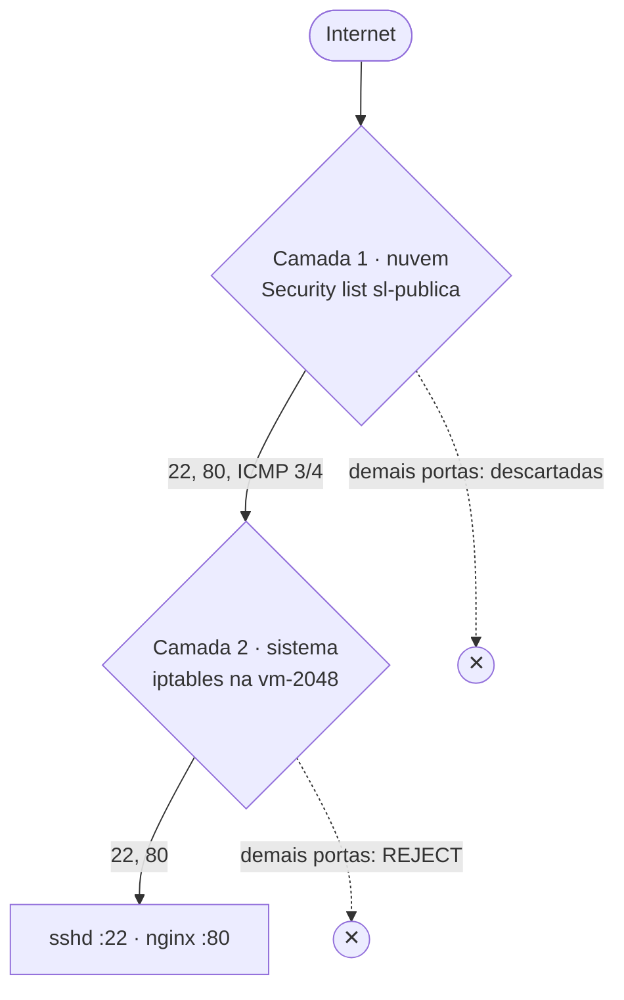

# 05 · Deixar o servidor mínimo e seguro

## Objetivo

Instalar só o necessário para servir o app, reduzir a superfície de ataque e provar com uma página simples que o servidor responde por HTTP antes de publicar o app real.

Todos os passos estão no script [`infra/server-setup.sh`](../infra/server-setup.sh). Ele é **idempotente**: rodar de novo reaplica o mesmo estado, sem duplicar nada. Assim o servidor pode ser reconstruído do zero com um comando.

> **NÃO EXECUTADO:** sem conta na Oracle não há servidor, então o script não foi rodado numa instância. O que foi verificado de verdade, no GitHub Actions (capítulo 08), é que o script passa no `shellcheck` e que a configuração do nginx passa no `nginx -t`. O comportamento descrito abaixo é o esperado, não o observado.

## O que seria instalado e por quê

| Pacote | Por quê |
|---|---|
| `nginx` | Servidor web que entrega os arquivos estáticos do 2048 na porta 80. É leve (poucas dezenas de MB de RAM), o que importa numa máquina de 1 GB |
| `rsync` | Recebe os arquivos de cada nova versão enviados pelo pipeline, transferindo só o que mudou |
| `unattended-upgrades` | Aplica atualizações de segurança automaticamente, sem eu precisar entrar no servidor |
| `iptables-persistent` | Grava as regras do firewall do sistema para que sobrevivam a um reinício. Já vem na imagem Ubuntu da OCI; o script só garante que está lá |

**O que fica de fora:**

- Nem Node.js nem banco de dados: o app é estático, o build acontece no GitHub Actions e o servidor só recebe o resultado.
- Nem `ufw`: a Oracle diz explicitamente para não usar o UFW nas imagens dela. As imagens trazem regras de firewall que permitem à instância falar com o próprio boot volume, e o UFW pode apagá-las; aí a instância não volta depois de um reboot ([Compute known issues](https://docs.oracle.com/en-us/iaas/Content/Compute/known-issues.htm)).
- Nem Docker: seria uma camada a mais sem benefício para um site estático.

`--no-install-recommends` evita trazer pacotes sugeridos que não são necessários.

## Usuários

| Usuário | Para quê | Restrições |
|---|---|---|
| `ubuntu` | Minha administração (vem com a imagem) | Entra só com a minha chave SSH. Tem `sudo` |
| `deploy` | Dono dos arquivos do app. É o usuário com que o pipeline entra | Senha bloqueada (`passwd -l`), **sem sudo**. A chave dele tem a opção `restrict` (sem port forwarding, agent ou terminal). Só pode escrever em `/var/www/2048` |

O nginx roda como `www-data` e só **lê** os arquivos, então um problema no nginx não dá permissão de alterar o site.

## Passo a passo reproduzível (planejado)

### 1. No meu computador (PowerShell): criar a chave exclusiva do pipeline e enviar os scripts

```powershell
# Chave só do GitHub Actions. Sem frase-senha (o pipeline não tem como digitá-la):
# ao ser perguntado, apertar Enter duas vezes.
ssh-keygen -t ed25519 -f "$env:USERPROFILE\.ssh\gha_deploy_2048" -C "github-actions-deploy-2048"

$KEY = "$env:USERPROFILE\.ssh\oci_2048_admin"
$IP  = "<IP-PUBLICO>"
scp -i $KEY -r infra "ubuntu@${IP}:~/infra"
scp -i $KEY "$env:USERPROFILE\.ssh\gha_deploy_2048.pub" "ubuntu@${IP}:~/"
```

### 2. No servidor: rodar a preparação

```bash
# Entrar pelo PowerShell: ssh -i $KEY "ubuntu@${IP}"   (comandos abaixo rodam no servidor)
sudo bash ~/infra/server-setup.sh "$(cat ~/gha_deploy_2048.pub)"
rm ~/gha_deploy_2048.pub
```

O script faz, nesta ordem:

1. `apt-get update` e `apt-get -y upgrade`.
2. Instala os 4 pacotes da tabela.
3. Cria o usuário `deploy`, bloqueia a senha dele e grava a chave pública do pipeline com `restrict`.
4. Cria `/var/www/2048/releases/` e uma página provisória "Servidor pronto", que vira o `current`.
5. Instala [`infra/nginx/2048.conf`](../infra/nginx/2048.conf), desativa o site padrão, valida com `nginx -t` e recarrega.
6. Endurece o SSH: sem senha, sem root, só `ubuntu` e `deploy`. Valida com `sshd -t` **antes** de recarregar, para não me trancar fora por erro de digitação.
7. Abre a porta 80 no firewall do sistema e grava as regras.

### 3. Conferir

```bash
systemctl is-enabled nginx unattended-upgrades   # enabled / enabled
sudo iptables -L INPUT -n --line-numbers         # 80 antes do REJECT
sudo sshd -T | grep -E 'passwordauthentication|permitrootlogin|allowusers'
curl -I http://127.0.0.1/                        # HTTP/1.1 200 OK
```

## Configuração do nginx

O que vale destacar em [`infra/nginx/2048.conf`](../infra/nginx/2048.conf):

- **`root /var/www/2048/current`.** `current` é um link simbólico para a versão publicada. O deploy troca o link de uma vez, então o visitante nunca vê uma versão pela metade (capítulo 08).
- **`server_tokens off`.** Não anuncia a versão do nginx.
- **Cabeçalhos de segurança:** `X-Content-Type-Options`, `X-Frame-Options: DENY` e `Referrer-Policy`.
- **Arquivos ocultos bloqueados:** `location ~ /\.` com `deny all`.
- **Cache:** `index.html` e `version.txt` nunca ficam em cache, para a nova versão aparecer logo. Os demais arquivos ficam em cache por 1 hora.

## Firewall em duas camadas

As duas camadas são independentes: um pacote só chega ao nginx se **as duas** deixarem passar. Se uma for mal configurada, a outra ainda protege.



**Camada 1: security list da OCI.** Regras no capítulo 03.

**Camada 2: iptables no Ubuntu.** A imagem Ubuntu da Oracle já vem com regras que aceitam conexões estabelecidas, ICMP, loopback e SSH, e **rejeitam todo o resto** com uma regra `REJECT` no fim da cadeia `INPUT`. Por isso uma regra nova não pode simplesmente ir para o fim: ficaria depois do `REJECT` e nunca seria usada. O script insere a regra da porta 80 **na posição do REJECT**, empurrando-o para baixo, e grava com `netfilter-persistent save` em `/etc/iptables/rules.v4`, que é o arquivo indicado pela Oracle ([Compute known issues](https://docs.oracle.com/en-us/iaas/Content/Compute/known-issues.htm)).

Regras esperadas depois do script (`sudo iptables -L INPUT -n --line-numbers`):

| # | Ação | Regra | Motivo |
|---|---|---|---|
| 1 | ACCEPT | `state RELATED,ESTABLISHED` | Respostas de conexões já aceitas |
| 2 | ACCEPT | `icmp` | Diagnóstico de rede |
| 3 | ACCEPT | interface `lo` | Tráfego local da própria máquina |
| 4 | ACCEPT | `udp spt:123` | Respostas de NTP (relógio) |
| 5 | ACCEPT | `tcp dpt:22 state NEW` | SSH |
| 6 | ACCEPT | `tcp dpt:80 ctstate NEW` | **HTTP, adicionada pelo script** |
| 7 | REJECT | todo o resto | Bloqueio padrão |

> **NÃO EXECUTADO:** evidência prevista: recorte da saída de `sudo iptables -L INPUT -n --line-numbers` depois do script.

## Teste com página simples (planejado)

Antes do app real, o `current` aponta para a página provisória "Servidor pronto" criada pelo script. Acessar `http://<IP-PUBLICO>/` no navegador prova que as duas camadas de firewall, o nginx e a rota estão certos.

> **NÃO EXECUTADO:** evidência prevista: recorte do navegador em `http://<IP-PUBLICO>/` mostrando "Servidor pronto", com o status 200 na aba Rede das ferramentas do desenvolvedor.

## Registro

- **Objetivo:** servidor com o mínimo instalado, SSH endurecido, firewall em duas camadas e HTTP respondendo.
- **O que fiz:** escrevi o script de preparação, com validações antes de cada recarga (`nginx -t` e `sshd -t`). Ele passou na checagem do `shellcheck` e a configuração do nginx passou no `nginx -t`, as duas no GitHub Actions.
- **Cuidado previsto:** as alterações de SSH só são aplicadas depois de `sshd -t` passar, e a sessão SSH atual deve ficar aberta até uma segunda conexão funcionar. Um erro ali trancaria o administrador fora do servidor.
- **O que não fiz:** não rodei o script num servidor, porque não há instância. Também não há recortes de tela do firewall nem da página de teste.
- **Risco que não foi testado:** se a imagem não tiver a regra `REJECT` no fim da cadeia `INPUT`, o script para com uma mensagem em vez de adivinhar as regras.

## Fontes

- Oracle. *Compute known issues* (UFW e iptables nas imagens Ubuntu). <https://docs.oracle.com/en-us/iaas/Content/Compute/known-issues.htm>
- Oracle. *Best practices for your compute instance.* <https://docs.oracle.com/en-us/iaas/Content/Compute/References/bestpracticescompute.htm>
- nginx. *Core module and http headers documentation.* <https://nginx.org/en/docs/>
- Ubuntu. *Automatic updates (unattended-upgrades).* <https://documentation.ubuntu.com/server/how-to/software/automatic-updates/>
- **Uso de IA:** o Claude (Anthropic) escreveu o rascunho do script de preparação e a explicação. Revisei o script. Ele não foi executado num servidor.
