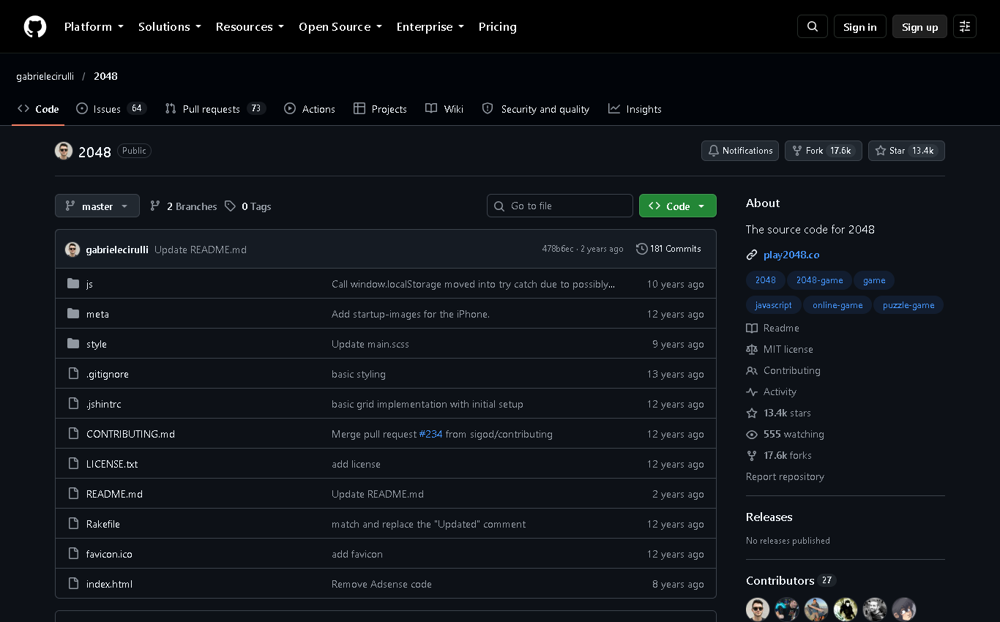
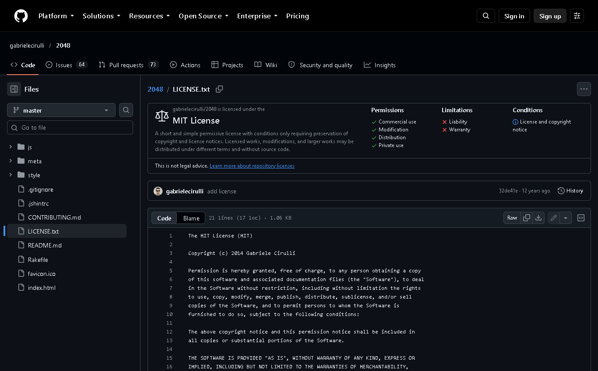
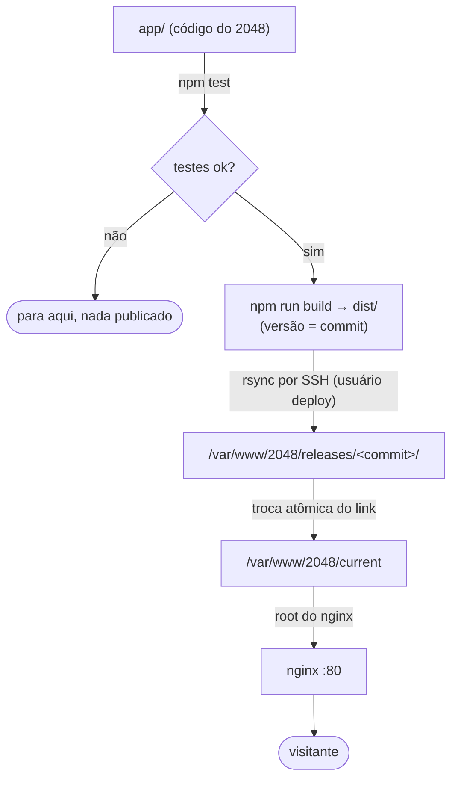

# 06 · Escolher o app pronto

## Objetivo

Escolher um app já existente, com licença que permita copiar e publicar, que caiba no servidor gratuito e que deixe visível, a cada deploy, que a versão mudou.

## O app

| Item | Valor |
|---|---|
| Nome | **2048** |
| Autor | Gabriele Cirulli |
| Origem | <https://github.com/gabrielecirulli/2048> (commit `478b6ec`, de 24/10/2024) |
| Licença | MIT ("The MIT License (MIT), Copyright (c) 2014 Gabriele Cirulli") |
| O que é | Jogo de quebra-cabeça para navegador, em HTML, CSS e JavaScript puros |





**O que a licença MIT permite:** usar, copiar, modificar, publicar e distribuir, inclusive comercialmente. A condição é **manter o aviso de copyright e o texto da licença** em todas as cópias. Por isso `app/LICENSE.txt` foi copiado sem alteração e a página do jogo cita o autor e a licença.

## Motivo da escolha

| Critério | Como o 2048 atende |
|---|---|
| Licença permissiva | MIT |
| Cabe no Always Free | É estático. O nginx serve os arquivos com poucos MB de RAM, então o E2.1.Micro de 1 GB sobra |
| Sem segredo nem banco | Não há senha de banco nem chave de API para proteger. O foco fica no pipeline |
| Testável | A lógica do jogo (`GameManager`) recebe os componentes do navegador pelo construtor, o que permite testá-la em Node.js com componentes falsos. Isso dá ao CI uma etapa de teste de verdade, não só um "ok" |
| Mudança visível | Basta alterar um texto ou o número de versão no rodapé para comprovar o deploy (capítulo 08) |

**Alternativas descartadas:**

- **Uptime Kuma:** precisa de Node.js rodando no servidor e o build dele é pesado para 1 GB.
- **Wiki.js e Etherpad:** precisam de banco e de mais memória.
- **Apps móveis:** só a distribuição do pacote ficaria no servidor, o que tira o foco do deploy.

## Como o app é construído e executado

O 2048 não tem etapa de compilação obrigatória: `index.html` carrega `style/main.css` (o Sass já vem compilado) e dez scripts em `js/`. O ponto de entrada é `js/application.js`, que cria o `GameManager` quando o navegador está pronto para desenhar.

Neste repositório, o app fica em [`app/`](../app/) e passa por um build mínimo, [`scripts/build.mjs`](../scripts/build.mjs), que:

1. copia `app/` para `dist/`;
2. troca `__APP_VERSION__` e `__BUILD_DATE__` no rodapé do `index.html` pelo commit (7 caracteres) e pela data do build;
3. grava `dist/version.txt` com o commit, que o pipeline usa para conferir que a versão nova está no ar.

**Alterações feitas no app original:**

- A nota "This site is the official version of 2048" foi trocada por um aviso de que se trata de uma cópia não oficial, para fins acadêmicos, com link para o projeto original. Manter a frase original seria falso.
- Foi acrescentada a linha "Versão publicada", com o commit e a data do build.

## Requisitos para rodar

| Requisito | Valor |
|---|---|
| Runtime no servidor | Nenhum além de um servidor web estático (nginx) |
| Runtime para build e testes | Node.js 22 (só no GitHub Actions e na máquina de desenvolvimento) |
| Portas | 80/TCP (HTTP) |
| Banco de dados | Nenhum. O placar e o jogo em andamento ficam no `localStorage` do navegador do jogador |
| Variáveis de ambiente | Nenhuma em produção. No build, `GITHUB_SHA` (fornecida pelo Actions) define a versão |
| Espaço em disco | Cerca de 1 MB por versão. O servidor guarda as 5 mais recentes |

## Plano de publicação no servidor



1. **Manual, primeiro** (capítulo 07): build na minha máquina, cópia por `scp` e ativação com o mesmo script que o pipeline usará.
2. **Automático, depois** (capítulo 08): o GitHub Actions faz exatamente esses passos a cada push na `main`.

## Teste local

Antes de pensar em servidor, o app foi testado na minha máquina:

```powershell
npm.cmd test        # 10 testes: regras do jogo, arquivos do site e build
npm.cmd run build   # gera dist/
npm.cmd run serve   # http://127.0.0.1:8080
```

(No PowerShell do Windows, `npm.cmd` funciona mesmo quando a política de execução bloqueia o `npm.ps1`.)


## Registro

- **Objetivo:** escolher um app adequado e entender como ele roda.
- **O que fiz:** comparei alternativas, confirmei a licença no repositório original, copiei o app com a licença, escrevi o build de versão e os testes, e rodei localmente.
- **O que deu errado:** o primeiro teste da regra "uma peça funde no máximo uma vez por jogada" usava a linha `[2, 2, 2, 2]`. Ao remover essa regra do código de propósito (teste por mutação), o teste **continuou passando**, porque essa linha não exercita a regra. Uma segunda tentativa de mutação, de outra regra, também pareceu "sobreviver", mas era o comando `sed` que não tinha casado com o texto e não alterou nada.
- **Como corrigi:** troquei a linha do teste por `[2, 2, 4, 0]`. O 4 recém-formado não pode se fundir com o 4 vizinho, e com a regra removida o teste falha, como deve. Para as mutações, passei a comparar o arquivo com a cópia de segurança (`cmp`) antes de ler o resultado. Cada um dos 5 testes de regra foi derrubado pela mutação correspondente.

## Fontes

- Cirulli, G. *2048* (código-fonte). <https://github.com/gabrielecirulli/2048>
- Open Source Initiative. *The MIT License.* <https://opensource.org/license/mit>
- Node.js. *Test runner (`node:test`).* <https://nodejs.org/api/test.html>
- **Uso de IA:** o Claude (Anthropic) sugeriu o app, escreveu os testes e o build e rodou os testes por mutação. Revisei as escolhas.
