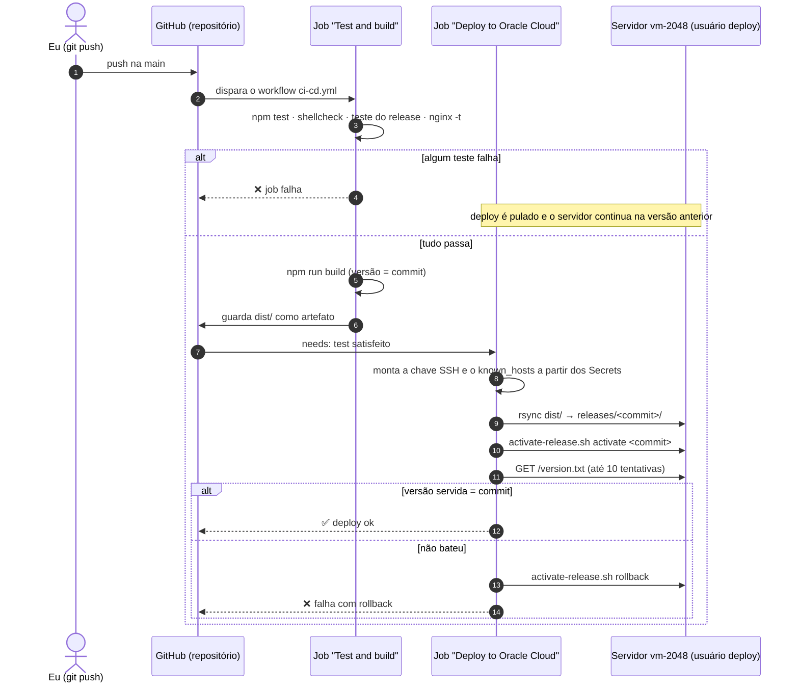

# 08 · Montar o CI/CD com GitHub

## Objetivo

Fazer com que um `git push` na branch `main` leve a mudança ao servidor sem que eu entre nele: testar, gerar o build, enviar, ativar e conferir, tudo pelo GitHub Actions.

## Repositório

**Link:** _a preencher_ (`https://github.com/<usuário>/trabalho-devops`)

> **PENDENTE:** colocar o link real do repositório aqui e na capa.

| Pasta | Conteúdo |
|---|---|
| `app/` | Código do 2048 com a licença MIT original |
| `tests/` | Testes das regras do jogo, do site e do build, mais o teste do script de release |
| `scripts/` | Build do site, servidor local, captura de telas e geração deste PDF |
| `infra/` | Preparação do servidor, configuração do nginx e script de ativação de release |
| `.github/workflows/ci-cd.yml` | O pipeline |
| `docs/` | Os nove capítulos em Markdown (fonte deste PDF) e as imagens |

## CI e CD

- **CI (Integração Contínua):** a cada push ou pull request, o código é testado e o build é gerado automaticamente. A pergunta que o CI responde é: "este código está bom para entrar?". Um erro é detectado minutos depois do commit, não no servidor.
- **CD (Entrega/Implantação Contínua):** o que passou no CI é publicado automaticamente. Aqui é *Continuous Deployment*: não há aprovação manual, e todo push na `main` que passa nos testes vai ao ar.

No GitHub Actions, os dois são **jobs** do mesmo **workflow**. O job de deploy declara `needs: test`, então só roda se o de teste terminar com sucesso ([Workflow syntax](https://docs.github.com/en/actions/reference/workflows-and-actions/workflow-syntax)).

## Onde fica o workflow e o gatilho

Workflows ficam em `.github/workflows/` no próprio repositório, em YAML. O gatilho é definido em `on:`:

```yaml
on:
  push:
    branches: [main]      # push na main: testa e publica
  pull_request:
    branches: [main]      # pull request: só testa, nunca publica
  workflow_dispatch:      # botão "Run workflow" para rodar à mão
```

## Diagrama do fluxo



## Etapas do workflow e sua função

Arquivo: [`.github/workflows/ci-cd.yml`](../.github/workflows/ci-cd.yml).

**Job `test` (Test and build)**, roda em todo push e pull request:

| Etapa | Função |
|---|---|
| Check out the code | Baixa o repositório no runner |
| Set up Node.js | Instala o Node 22 |
| Unit and site tests | `npm test`: 5 testes das regras do jogo, 4 do site (arquivos referenciados existem, scripts sem erro de sintaxe, licença presente) e 1 do build |
| Lint the server scripts | `shellcheck` nos scripts de `infra/`, que pega erros comuns de shell antes de chegarem ao servidor |
| Test the release switch script | Roda `activate-release.sh` numa pasta temporária: ativação, rollback, recusa de versão inexistente, recusa de `../../etc` e limpeza de versões antigas |
| Validate the nginx config | `nginx -t` com a configuração do repositório. Um erro de sintaxe é pego aqui, não no servidor |
| Build | `npm run build`: gera `dist/` com o commit no rodapé e em `version.txt` |
| Keep the build for the deploy job | Guarda `dist/` como artefato. O deploy publica **exatamente** o que foi testado, sem refazer o build |

**Job `deploy` (Deploy to Oracle Cloud)**, roda só em push na `main`, depois do `test`, e só se a variável `DEPLOY_ENABLED` for `true`:

| Etapa | Função |
|---|---|
| Check out the deploy scripts | Precisa do `infra/activate-release.sh` |
| Download the build | Pega o `dist/` produzido pelo job anterior |
| Configure SSH with the pipeline key | Grava a chave privada e o `known_hosts` vindos dos Secrets. Com `StrictHostKeyChecking yes`, a conexão falha se o servidor não for o esperado |
| Upload the release | `rsync` de `dist/` para `releases/<commit>/` como usuário `deploy` |
| Activate the release | Roda o script de ativação no servidor: troca atômica do link `current` |
| Health check (rolls back on failure) | Lê `http://<IP>/version.txt` até 10 vezes. Se a versão servida não for o commit, faz rollback para a anterior e marca o job como falho |

**Outras proteções do workflow:**

- `permissions: contents: read`: o token do GitHub dentro do job só pode ler o repositório.
- `concurrency`: dois pushes seguidos não fazem deploy ao mesmo tempo; o segundo espera o primeiro.
- `environment: production`: o deploy aparece na página **Deployments** do repositório, com o link do app.

## Segredos usados e como foram protegidos

| Nome | Tipo | Conteúdo | Proteção |
|---|---|---|---|
| `SSH_PRIVATE_KEY` | Secret | Chave privada **exclusiva do pipeline** (`gha_deploy_2048`), sem frase-senha | Criptografada pelo GitHub e mascarada nos logs. Fica num arquivo com permissão 600 só durante o job, num runner descartável. A chave pública correspondente só entra no usuário `deploy`, que não tem sudo, com a opção `restrict` |
| `SSH_KNOWN_HOSTS` | Secret | Linha `known_hosts` com a chave do servidor | Impede que o pipeline mande arquivos para um servidor impostor |
| `SSH_HOST` | Secret | IP público do servidor | Fica fora do código e mascarado nos logs |
| `DEPLOY_ENABLED` | Variable | `true` | Liga o deploy só depois de o servidor existir. Antes disso, o CI roda e o deploy fica pulado |
| `APP_URL` | Variable | `http://<IP-PUBLICO>` | Endereço usado no health check e no link do environment |

**Por que uma chave exclusiva para o pipeline:** se ela vazar, o estrago fica limitado ao que o usuário `deploy` pode fazer, que é trocar arquivos do site. O acesso de administração continua seguro. Para revogar, basta apagar a linha dela em `/home/deploy/.ssh/authorized_keys`.

**Nada sensível fica no repositório.** O `.gitignore` bloqueia arquivos de chave (`*_key`, `id_*`, `*.pem`), e os Secrets não são entregues a workflows disparados por forks ([Using secrets](https://docs.github.com/en/actions/how-tos/write-workflows/choose-what-workflows-do/use-secrets)). Secrets não podem ser usados em condições `if:` de job; por isso a chave liga/desliga é uma **variable** ([Contexts](https://docs.github.com/en/actions/reference/workflows-and-actions/contexts)).

### Como cadastrar (PowerShell, com o GitHub CLI autenticado)

```powershell
$IP = "<IP-PUBLICO>"

# 1. Chave privada do pipeline (criada no capítulo 05)
Get-Content -Raw "$env:USERPROFILE\.ssh\gha_deploy_2048" | gh secret set SSH_PRIVATE_KEY

# 2. Chave do servidor: obter e CONFERIR com a que aceitei no primeiro login (capítulo 04)
ssh-keyscan -t ed25519 $IP | Out-File -Encoding ascii known_hosts_server.txt   # ">" gravaria UTF-16 no PowerShell 5.1
ssh-keygen -lf known_hosts_server.txt                       # impressão digital obtida agora
ssh-keygen -lF $IP -f "$env:USERPROFILE\.ssh\known_hosts"   # impressão digital do primeiro login
# Só continuar se as duas forem iguais.
Get-Content -Raw known_hosts_server.txt | gh secret set SSH_KNOWN_HOSTS
Remove-Item known_hosts_server.txt

# 3. Endereço e chave liga/desliga
gh secret set SSH_HOST --body $IP
gh variable set APP_URL --body "http://$IP"
gh variable set DEPLOY_ENABLED --body "true"
```


> **PENDENTE:** recorte da página de Secrets do repositório (o GitHub mostra só os nomes).

## Execução com sucesso


> **PENDENTE:** recorte de uma execução em que **Test and build** e **Deploy to Oracle Cloud** terminaram em verde, com o passo do health check aberto mostrando "Release ... is live".

## Falha tratada

**Cenário:** um commit que quebra uma regra do jogo. Por exemplo, remover `&& !next.mergedFrom` em `app/js/game_manager.js`, o que deixa uma peça se fundir duas vezes na mesma jogada.

**O que acontece:**

1. O job **Test and build** falha no passo *Unit and site tests*: "a tile created by a merge does not merge again in the same move".
2. O job **Deploy** aparece como **skipped**: nada é enviado ao servidor.
3. O site continua no ar, na versão anterior.
4. **Correção:** `git revert` do commit, novo push e pipeline verde.

O pipeline também trata outra falha, depois do envio: se o health check não encontrar a versão nova no ar, o job faz rollback automático para a versão anterior.


> **PENDENTE:** recorte da execução com o job de teste em vermelho (mostrando o teste que falhou) e o deploy como skipped. Em seguida, recorte da execução do revert em verde.

## Prova de deploy automático

**Mudança:** trocar o texto de introdução em `app/index.html` de "Join the numbers and get to the **2048 tile!**" para "Junte os números e chegue ao bloco **2048!**". Depois fazer commit e push, **sem entrar no servidor**.

```powershell
git commit -am "Traduz a introdução do jogo"
git push
```

| | Antes do push | Depois do push |
|---|---|---|
| Texto de introdução | "Join the numbers…" | "Junte os números…" |
| Rodapé "Versão publicada" | commit anterior | commit novo |
| `http://<IP>/version.txt` | commit anterior | commit novo |


> **PENDENTE:** os dois recortes acima, do navegador no IP público, com o rodapé de versão visível.

## Registro

- **Objetivo:** push na `main` leva a mudança ao servidor, com teste antes e possibilidade de rollback.
- **O que fiz:** escrevi o workflow com dois jobs, uma chave SSH exclusiva, o host fixado em `known_hosts`, o health check com rollback e o teste do script de release no próprio CI.
- **O que deu errado:**
  - O teste do script de release não roda no Windows: o Git Bash não cria links simbólicos sem privilégio de administrador ("Operation not permitted").
  - O `node --test tests/` do Node 22 não aceita uma pasta como argumento ("Cannot find module").
- **Como corrigi:**
  - O teste do script de release roda só no runner Linux do GitHub, que é onde ele importa.
  - Troquei o argumento do `node --test` pelo padrão `"tests/**/*.test.mjs"`.

> **PENDENTE:** acrescentar o que deu errado nas primeiras execuções reais do pipeline (por exemplo: `Host key verification failed`, `Permission denied (publickey)`, health check esgotando as tentativas) e como foi resolvido.

## Fontes

- GitHub. *Workflow syntax for GitHub Actions.* <https://docs.github.com/en/actions/reference/workflows-and-actions/workflow-syntax>
- GitHub. *Using secrets in GitHub Actions.* <https://docs.github.com/en/actions/how-tos/write-workflows/choose-what-workflows-do/use-secrets>
- GitHub. *Store information in variables.* <https://docs.github.com/en/actions/how-tos/write-workflows/choose-what-workflows-do/use-variables>
- GitHub. *Contexts reference.* <https://docs.github.com/en/actions/reference/workflows-and-actions/contexts>
- GitHub. *Managing environments for deployment.* <https://docs.github.com/en/actions/how-tos/deploy/configure-and-manage-deployments/manage-environments>
- OpenSSH. *sshd(8)*, seção AUTHORIZED_KEYS (opção `restrict`). <https://man.openbsd.org/sshd#AUTHORIZED_KEYS_FILE_FORMAT>
- **Uso de IA:** o Claude (Anthropic) escreveu o workflow, os scripts e este capítulo. Revisei, cadastrei os segredos e executei os pushes de prova.
