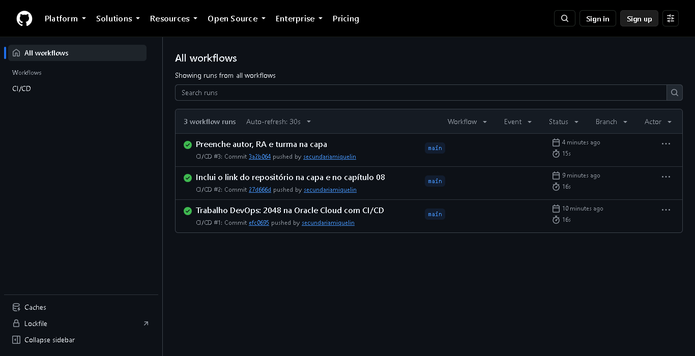

# 09 · Validar e refletir

## Objetivo

Fechar o ciclo: comprovar que os três objetivos funcionam, conferir que não ficou nenhum custo nem recurso esquecido e registrar limitações, riscos e aprendizados.

> **NÃO EXECUTADO (em parte):** a conta na Oracle não foi criada, então os objetivos que dependem da nuvem não puderam ser comprovados. Este capítulo diz com clareza o que foi comprovado e o que ficou só no planejamento.

## Revalidação como outra pessoa

A parte que não depende da nuvem foi refeita seguindo só a documentação:

- `npm.cmd test`: 10 testes passando;
- `npm.cmd run build` e `npm.cmd run serve`: app abrindo em `http://127.0.0.1:8080` com o rodapé de versão;
- push no GitHub disparando o workflow, com o CI verde.

Os roteiros dos capítulos 02 a 05 e 07 não foram refeitos, porque dependem da conta na Oracle.

## Checklist dos três objetivos

| # | Objetivo | Como verificar | Situação |
|---|---|---|---|
| 1 | **Oracle Cloud Free Tier:** conta protegida, com alerta de gasto e só recursos Always Free | Console: MFA ativo, budget de US$ 1 com 2 regras, instância E2.1.Micro com rótulo *Always Free-eligible*, custo do mês US$ 0,00 em **Billing & Cost Management > Cost Analysis** | **Não executado.** Conta não criada |
| 2 | **Servidor mínimo:** só o necessário, firewall em duas camadas, SSH só por chave, app sobrevive a reboot | `iptables -L`, `sshd -T`, security list, teste de reboot (capítulo 07) | **Parcial.** Scripts prontos e validados no CI (`shellcheck` e `nginx -t`), mas não executados num servidor |
| 3 | **Pipeline com GitHub:** push na `main` publica sem entrar no servidor, e falha não publica | Aba Actions (sucesso e falha), rodapé de versão antes e depois | **Parcial.** CI funcionando de verdade (3 execuções verdes). O deploy (CD) não rodou por falta de servidor |

> **NÃO EXECUTADO:** evidências previstas para os objetivos 1 e 2: recorte do **Cost Analysis** com US$ 0,00 no mês e recorte do app no IP público depois do reboot.

## Verificação de custo e recursos esquecidos

Como a conta não foi criada, não existe recurso esquecido nem risco de cobrança. A tabela abaixo fica como roteiro de verificação para quando houver conta.

| Verificação | Onde | Esperado |
|---|---|---|
| Recursos criados no compartment | **Governance > Tenancy Explorer**, compartment `trabalho-devops` | Só: VCN, subnet, IGW, route table, security list, instância, boot volume, VNIC |
| Boot volumes órfãos | **Storage > Boot Volumes** | Nenhum volume sem instância (sobra quando uma instância é encerrada sem apagar o volume) |
| Volumes extras ou backups | **Storage > Block Volumes / Backups** | Nenhum |
| IPs reservados | **Networking > Reserved Public IPs** | Nenhum (uso o IP efêmero) |
| Load balancers | **Networking > Load Balancers** | Nenhum |
| Instâncias de teste em outras regiões | Seletor de região | Nenhuma |
| Status da conta | **Billing > Upgrade and Manage Payment** | Free Tier, sem upgrade |
| Budget | **Billing > Budgets** | US$ 1, nenhum alerta disparado |

## Limitações do ambiente gratuito

- **Desempenho:** o E2.1.Micro tem 1/8 de OCPU (com uso adicional quando há CPU ociosa no host) e 1 GB de RAM. Serve um site estático com folga, mas não aguentaria um app com banco ou build no servidor.
- **Banda:** 50 Mbps para a internet no Micro. Muitos acessos simultâneos a arquivos grandes ficariam lentos.
- **Recuperação por ociosidade:** um site pouco visitado pode ser considerado ocioso (CPU no percentil 95 e rede abaixo de 20% por 7 dias) e a instância pode ser recuperada pela Oracle. Para um site estático com pouco tráfego, isso é um risco real. A doc não garante aviso prévio no e-mail, então convém conferir o console de vez em quando.
- **Capacidade:** shapes gratuitos, principalmente o A1, podem estar esgotados ("Out of host capacity"). Recriar a instância pode não ser possível na hora.
- **Região fixa:** tudo fica preso à região home escolhida no cadastro.
- **Sem HTTPS:** sem domínio próprio, o app é servido por HTTP. O navegador mostra "Não seguro" e o conteúdo trafega sem criptografia (é um jogo, sem dados pessoais).
- **IP efêmero:** o IP público pode mudar se a instância for parada e iniciada pela Oracle ou recriada. Nesse caso, `APP_URL`, `SSH_HOST` e `SSH_KNOWN_HOSTS` precisam ser atualizados.
- **Ponto único de falha:** uma VM, sem balanceador e sem réplica. Se ela cair, o site cai.

## Riscos de segurança que restam e melhorias possíveis

| Risco | Por que existe | Melhoria possível |
|---|---|---|
| Porta 22 aberta para a internet inteira | Os runners do GitHub não têm IP fixo | (a) runner self-hosted dentro da VCN; (b) o workflow libera o IP do runner na security list pela API da OCI só durante o deploy; (c) acesso pelo OCI Bastion; (d) VPN como Tailscale ou WireGuard |
| Tentativas de login por força bruta nos logs | Consequência da porta 22 aberta | Senha já está desativada. Dá para acrescentar `fail2ban` ou limite de taxa no iptables |
| Chave do pipeline sem frase-senha | O pipeline não tem como digitá-la | Mitigado no projeto: usuário sem sudo, `restrict` e escopo só em `/var/www/2048`. Melhoria: forçar um comando fixo no `authorized_keys` (`command=`) que só aceite rsync para `releases/` |
| HTTP sem TLS | Sem domínio | Usar um nome via `sslip.io` ou um domínio próprio com Let's Encrypt (`certbot --nginx`) e abrir a 443 |
| Ações de terceiros no workflow (`actions/checkout`, etc.) | O workflow confia no código delas | Fixar as ações por hash de commit em vez de tag e ativar o Dependabot para elas |
| Sem monitoramento externo | Se o site cair, ninguém é avisado | Monitor gratuito de uptime ou um alarme do OCI Monitoring com Notifications (Always Free) |
| Sem cópia de segurança da configuração do servidor | O servidor é reconstruível pelos scripts | Mitigado no projeto: `server-setup.sh` + pipeline recriam tudo. Melhoria: provisionar a rede e a instância com Terraform (OCI Resource Manager é Always Free) |

## Aprendizados pessoais

> **PENDENTE:** escrever em primeira pessoa, em um ou dois parágrafos curtos, o que aprendi. Sugestões de pontos: o que achava de "deploy" antes e depois; o que mais surpreendeu (por exemplo, o firewall do sistema bloqueando mesmo com a security list aberta, ou a diferença entre os limites dos tutoriais e os da documentação oficial); o que eu faria diferente (por exemplo, começar pelo budget, escolher A1 ou Micro, automatizar a rede com Terraform). Este texto precisa ser meu, não da IA.

## O que faria diferente

- Provisionaria a rede e a instância com Terraform desde o início, para que o capítulo 03 também fosse reproduzível por comando.
- Resolveria o HTTPS logo no começo, com um nome `sslip.io`.
- Restringiria a porta 22 com runner self-hosted ou liberação dinâmica do IP do runner.
- Testaria os scripts do servidor numa máquina virtual local com Ubuntu, para validá-los de ponta a ponta mesmo sem a nuvem.

## Declaração de uso de IA

Este trabalho usou o **Claude (Anthropic)**, pelo Claude Code, como assistente para:

- pesquisar e resumir a documentação oficial (capítulos 01 a 05 e 08);
- escolher o app e escrever o build, os testes, os scripts de servidor e o workflow;
- escrever os rascunhos dos capítulos e o script que gera este PDF.

O assistente também, no meu computador e com a minha autorização:

- rodou os testes, o build e o app localmente;
- criou o repositório público no GitHub e fez os pushes;
- capturou as telas de páginas públicas: documentação da Oracle, repositório do 2048, app local e aba Actions.

Os números da Oracle foram conferidos na página oficial. **Nada foi executado na Oracle Cloud:** não há conta, rede, instância, servidor, segredos de deploy nem endereço público. Os capítulos correspondentes descrevem o planejamento e estão marcados como não executados.

## Fontes

- Oracle. *Always Free Resources* (instâncias ociosas e capacidade). <https://docs.oracle.com/en-us/iaas/Content/FreeTier/freetier_topic-Always_Free_Resources.htm>
- Oracle. *Tenancy Explorer.* <https://docs.oracle.com/en-us/iaas/Content/General/Concepts/compartmentexplorer.htm>
- GitHub. *Security hardening for GitHub Actions* (fixar ações por hash). <https://docs.github.com/en/actions/reference/security/secure-use>
- Let's Encrypt. *Getting started.* <https://letsencrypt.org/getting-started/>
